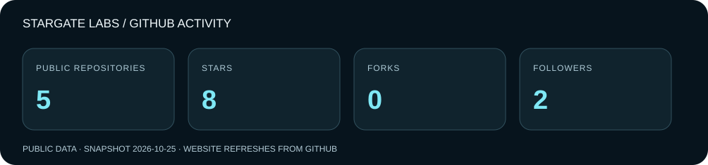

# Software, security and hardware. Engineered together.

Stargate Labs is an independent software development and hardware research lab. I build operational applications, analysis tools and integrations for devices with limited protocol documentation. Reverse engineering provides the understanding needed to build a verifiable interface.

[Italiano](README.md) · [English](README.en.md) · [Portfolio IT](https://stargatelabs.github.io/StargateLabs/) · [Portfolio EN](https://stargatelabs.github.io/StargateLabs/index-en.html)

## SignalRGB · Hardware interoperability

 &nbsp; 

A laboratory workflow: observation, protocol analysis, implementation and testing. Public code includes installation guides and clearly scoped validation notes.

| Project | Implementation | Guides |
|---|---|---|
| [Stream Controller X](https://github.com/StargateLabs/signalrgb-razer-stream-controller-x) | SignalRGB effects across 15 keys as one continuous 480 × 288 image. RGB565 transport, tile-based transfers and full-framebuffer checks. | [IT](https://github.com/StargateLabs/signalrgb-razer-stream-controller-x/blob/main/docs/INSTALL-IT.md) · [EN](https://github.com/StargateLabs/signalrgb-razer-stream-controller-x/blob/main/docs/INSTALL-EN.md) |
| [Key Light Chroma](https://github.com/StargateLabs/signalrgb-razer-key-light-chroma) | Control of the RGB section through the lamp’s local protocol: TCP setup, UDP frames and connection recovery. 77 automated checks. | [IT](https://github.com/StargateLabs/signalrgb-razer-key-light-chroma/blob/main/docs/INSTALL-IT.md) · [EN](https://github.com/StargateLabs/signalrgb-razer-key-light-chroma/blob/main/docs/INSTALL-EN.md) |
| [LSC / Battletron](https://github.com/StargateLabs/signalrgb-lsc-battletron-bridge) | A Rust bridge for LSC and Battletron Wi-Fi lights: QR login, authenticated LAN streaming, device management and configuration recovery. | [IT](https://github.com/StargateLabs/signalrgb-lsc-battletron-bridge/blob/main/docs/INSTALL-IT.md) · [EN](https://github.com/StargateLabs/signalrgb-lsc-battletron-bridge/blob/main/docs/INSTALL-EN.md) |

## Projects and capabilities

### ShipExpress

A production platform for shipping, orders, inventory and business documents. Multi-tenant architecture with separate databases, carrier integrations and search tools for operational documentation.

[Project](https://shipexpress.it)

### ARGUS

Security assessment orchestration for authorized targets: reconnaissance, static and dynamic analysis, dependencies, exposed credentials and APIs. Results from individual tools feed a shared analysis workflow.

### ARA

A voice assistant combining Whisper transcription, Kokoro speech synthesis and local document memory. Request routing and confirmation for sensitive operations keep conversation and execution clearly separated.

### StargateCryo

A dashboard for Intel Cryo controllers: regulation, telemetry, diagnostics and history. The desktop build integrates Core Temp clocks and Thermaltake TF2/TF3 sensors; thresholds are setup-specific and missing measurements remain explicit.

[Project](https://github.com/StargateLabs/dashboard-for-intel-cryo-cooling-technology)

### Sistemi di raffreddamento

Design and testing of liquid loops and thermoelectric systems, including sensor acquisition, condensation management, controlled startup and documentation of the specific hardware limits.

## Engineering approach

- **Understand before changing.** Reconstruct flows, formats and constraints from code, traffic and observable behavior. Keep hypotheses separate from evidence.
- **Design for recovery.** Backups, reconnects, timeouts and missing-data handling are part of implementation alongside the primary feature.
- **Verify behavior.** Protocol tests, regression checks and physical device observations answer different questions. Documentation identifies the evidence behind each result.

## Stack and documentation

Rust · Python · TypeScript · React / Next.js · PostgreSQL · Redis / BullMQ · Docker / Linux · Vitest / Playwright · USB / HID / UART · TCP / UDP / BLE.

[Previous technical information remains available in the archive](docs/PROJECT-NOTES-2026-10.md): versions, capabilities and measurements retain their historical context. Current releases and verification results are described in the individual repositories.

## GitHub statistics and visits

 &nbsp; 

The visitor counter retains the profile’s existing identifier. The numeric card is a dated snapshot; repository badges are updated by their respective services. The portfolio refreshes its summaries through GitHub’s public API.

| Repository | Stars | Forks | Open issues and PRs |
|---|---:|---:|---:|
| [dashboard-for-intel-cryo-cooling-technology](https://github.com/StargateLabs/dashboard-for-intel-cryo-cooling-technology) |  |  | [GitHub](https://github.com/StargateLabs/dashboard-for-intel-cryo-cooling-technology/issues) |
| [signalrgb-lsc-battletron-bridge](https://github.com/StargateLabs/signalrgb-lsc-battletron-bridge) |  |  | [GitHub](https://github.com/StargateLabs/signalrgb-lsc-battletron-bridge/issues) |
| [signalrgb-razer-key-light-chroma](https://github.com/StargateLabs/signalrgb-razer-key-light-chroma) |  |  | [GitHub](https://github.com/StargateLabs/signalrgb-razer-key-light-chroma/issues) |
| [signalrgb-razer-stream-controller-x](https://github.com/StargateLabs/signalrgb-razer-stream-controller-x) |  |  | [GitHub](https://github.com/StargateLabs/signalrgb-razer-stream-controller-x/issues) |
| [StargateLabs](https://github.com/StargateLabs/StargateLabs) |  |  | [GitHub](https://github.com/StargateLabs/StargateLabs/issues) |

<b>Contributions, languages and contribution streak</b>

 

[Official contribution graph](https://github.com/StargateLabs#year-list-container)

## Contact

[info@shipexpress.it](mailto:info@shipexpress.it) · [shipexpress.it](https://shipexpress.it) · [GitHub](https://github.com/StargateLabs)

Razer, SignalRGB, Intel e gli altri marchi appartengono ai rispettivi titolari. Progetti indipendenti, senza affiliazione dichiarata.

