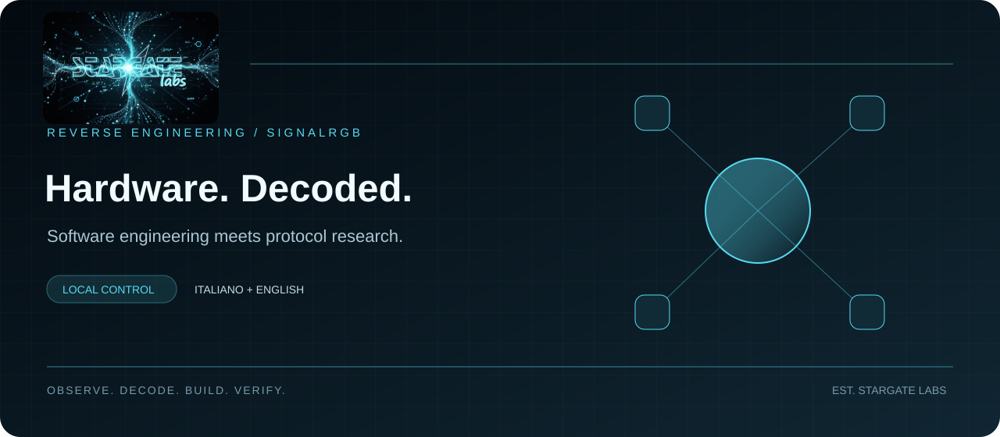

# Software, sicurezza e hardware. Progettati insieme.

Stargate Labs è un laboratorio indipendente di sviluppo software e ricerca hardware. Realizzo applicazioni operative, strumenti di analisi e integrazioni per dispositivi con protocolli poco documentati. Il reverse engineering serve a comprendere il sistema e costruire un’interfaccia verificabile.

[Italiano](README.md) · [English](README.en.md) · [Portfolio IT](https://stargatelabs.github.io/StargateLabs/) · [Portfolio EN](https://stargatelabs.github.io/StargateLabs/index-en.html)

## SignalRGB · Hardware interoperability

 &nbsp; 

Un metodo da laboratorio: osservazione, analisi del protocollo, implementazione e test. Il codice pubblico è accompagnato da guide d’installazione e indicazioni sui limiti del collaudo.

| Progetto | Implementazione | Guide |
|---|---|---|
| [Stream Controller X](https://github.com/StargateLabs/signalrgb-razer-stream-controller-x) | Effetti SignalRGB sui 15 tasti, con un’immagine continua a 480 × 288 pixel. Trasporto RGB565, trasferimenti per tile e test sull’intero framebuffer. | [IT](https://github.com/StargateLabs/signalrgb-razer-stream-controller-x/blob/main/docs/INSTALL-IT.md) · [EN](https://github.com/StargateLabs/signalrgb-razer-stream-controller-x/blob/main/docs/INSTALL-EN.md) |
| [Key Light Chroma](https://github.com/StargateLabs/signalrgb-razer-key-light-chroma) | Controllo della sezione RGB attraverso il protocollo locale della lampada: configurazione TCP, frame UDP e recupero della connessione. 77 controlli automatici. | [IT](https://github.com/StargateLabs/signalrgb-razer-key-light-chroma/blob/main/docs/INSTALL-IT.md) · [EN](https://github.com/StargateLabs/signalrgb-razer-key-light-chroma/blob/main/docs/INSTALL-EN.md) |
| [LSC / Battletron](https://github.com/StargateLabs/signalrgb-lsc-battletron-bridge) | Bridge Rust per luci Wi-Fi LSC e Battletron: login QR, stream LAN autenticato, gestione dei dispositivi e recupero della configurazione. | [IT](https://github.com/StargateLabs/signalrgb-lsc-battletron-bridge/blob/main/docs/INSTALL-IT.md) · [EN](https://github.com/StargateLabs/signalrgb-lsc-battletron-bridge/blob/main/docs/INSTALL-EN.md) |

## Progetti e competenze

### ShipExpress

Piattaforma gestionale per spedizioni, ordini, magazzino e documenti. Architettura multi-tenant con database separati e integrazioni con i corrieri; strumenti di ricerca per consultare la documentazione operativa.

[Progetto](https://shipexpress.it)

### ARGUS

Orchestrazione di verifiche di sicurezza su target autorizzati: ricognizione, analisi statica e dinamica, dipendenze, credenziali esposte e API. I risultati dei diversi strumenti confluiscono in un flusso di analisi comune.

### ARA

Assistente vocale con trascrizione Whisper, sintesi Kokoro e memoria documentale locale. Il routing delle richieste e le conferme sulle operazioni sensibili mantengono esplicito il confine tra conversazione ed esecuzione.

### StargateCryo

Dashboard per controller Intel Cryo: regolazione, telemetria, diagnostica e storico. La build desktop integra clock Core Temp e sensori Thermaltake TF2/TF3; le soglie dipendono dall’impianto e i dati mancanti restano riconoscibili.

[Progetto](https://github.com/StargateLabs/dashboard-for-intel-cryo-cooling-technology)

### TechDash

Monitoraggio di temperature CPU/GPU, carico, ventole, pompe e dischi. Una vista operativa dei sensori per correlare il comportamento del sistema con gli eventi termici e le condizioni del circuito.

### Sistemi di raffreddamento

Progettazione e collaudo di loop a liquido e sistemi termoelettrici. Il lavoro comprende acquisizione dei sensori, gestione della condensa, avvio controllato e documentazione dei limiti dell’hardware utilizzato.

## Metodo di lavoro

- **Comprendere prima di intervenire.** Ricostruisco flussi, formati e vincoli a partire da codice, traffico e comportamento osservabile. Le ipotesi restano distinte dalle prove.
- **Progettare il recupero.** Backup, riconnessioni, timeout e gestione dei dati mancanti fanno parte dell’implementazione, insieme alla funzionalità principale.
- **Verificare il comportamento.** Test di protocollo, controlli di regressione e prove sul dispositivo rispondono a domande diverse. La documentazione chiarisce quale verifica sostiene ogni risultato.

## Stack e documentazione

Rust · Python · TypeScript · React / Next.js · PostgreSQL · Redis / BullMQ · Docker / Linux · Vitest / Playwright · USB / HID / UART · TCP / UDP / BLE.

[Le informazioni tecniche precedenti sono conservate nell’archivio](docs/PROJECT-NOTES-2026-10.md): numeri di versione, funzionalità e misure mantengono il loro contesto storico. Le release recenti e i risultati verificati sono descritti nelle singole repository.

## Ricerca in corso

LotusLamp Bluetooth e gateway WB3S: analisi del protocollo e valutazione del firmware. Non sono ancora compatibilità rilasciate. I progetti privati sono descritti a livello funzionale; i relativi sorgenti non vengono pubblicati.

## Contatti

[info@shipexpress.it](mailto:info@shipexpress.it) · [shipexpress.it](https://shipexpress.it) · [GitHub](https://github.com/StargateLabs)

Razer, SignalRGB, Intel e gli altri marchi appartengono ai rispettivi titolari. Progetti indipendenti, senza affiliazione dichiarata.

